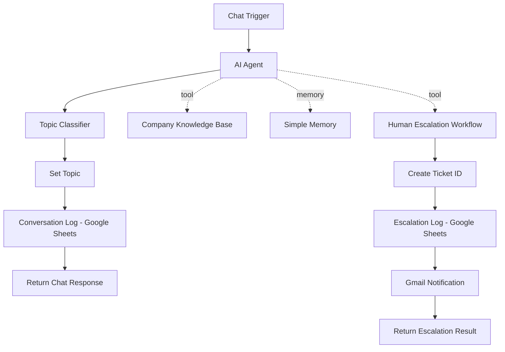

# AI Customer Support Chatbot

An n8n portfolio project that combines a grounded knowledge-base chatbot with memory, human escalation, ticketing, conversation logging, topic classification, email alerts, and support analytics.

## What it demonstrates

- AI customer support with an n8n AI Agent
- Retrieval from a company knowledge base
- Conversation memory
- Guardrails against unsupported business claims
- Human escalation through a callable n8n workflow
- Unique escalation ticket IDs
- Google Sheets logging for conversations and escalations
- Gmail notification to human support
- Topic classification for support analytics
- Clean customer-facing chat responses
- Refund/payment safety handling

## Architecture



## Repository structure

```text
ai-customer-support-chatbot/
├── README.md
├── workflows/
│   ├── ai-customer-support-chatbot.json
│   └── human-escalation-handler.json
├── docs/
│   ├── setup-guide.md
│   ├── workflow-overview.md
│   ├── analytics-setup.md
│   └── demo-knowledge-base.md
├── templates/
│   ├── conversation-logs.csv
│   └── escalations.csv
└── screenshots/
    └── README.md
```

## Main workflow

The main chatbot workflow handles incoming chat messages, retrieves company information, keeps short-term conversation memory, can escalate issues to a human, classifies each message by topic, logs the conversation, and returns only the final assistant response to the customer.

Current topic categories:

- Services
- Consultation
- Payments / Refunds
- Business Info
- Support / Complaints
- Other

## Human escalation workflow

The escalation workflow receives:

- `customer_message`
- `escalation_reason`
- `session_id`

It then:

1. Creates a unique ticket ID such as `ESC-20261011-6777`
2. Logs the case in Google Sheets
3. Sends an email notification to human support
4. Returns a success result and ticket ID to the AI Agent

The customer can then receive a concise confirmation such as:

> Human support has been notified. Your ticket ID is ESC-20261011-6777.

## Safety / grounding behavior

The chatbot is instructed to:

- use connected knowledge/tools for business facts
- avoid inventing prices, policies, package details, delivery times, or company claims
- avoid claiming actions unless a connected tool actually performed them
- avoid approving or promising refunds
- escalate sensitive cases such as fraud, payment disputes, legal threats, security issues, serious complaints, or unusual compensation requests
- keep post-escalation confirmations concise

## Setup

See [docs/setup-guide.md](docs/setup-guide.md).

At minimum you will need:

- n8n
- an OpenAI credential
- Google Sheets credentials
- Gmail credentials
- two Google Sheets:
  - `AI Chatbot Conversation Logs`
  - `AI Chatbot Escalations`

The public workflow JSON files contain placeholders instead of personal account IDs, sheet IDs, email addresses, workflow IDs, webhook IDs, or credentials.

## Demo knowledge base

The workflow includes a demo business called **BrightPath Digital** with example services, hours, consultation policy, refund handling, payment methods, escalation rules, privacy guidance, and location information.

See [docs/demo-knowledge-base.md](docs/demo-knowledge-base.md).

## Analytics

The conversation log supports:

- total conversations
- total escalations
- escalation rate
- normal conversations
- unique sessions
- most common topic
- customer support topic chart
- escalation overview chart

See [docs/analytics-setup.md](docs/analytics-setup.md).

## Test scenarios

Useful final tests:

| Scenario | Expected behavior |
|---|---|
| `What services do you offer?` | Grounded answer; topic `Services`; not escalated |
| `What does your SEO package include?` | No invented package details |
| `Can I get a refund?` | Refund policy stated; human escalation; ticket ID |
| `I want to speak to a human.` | Human escalation; ticket ID |
| `What are your opening hours?` | Grounded business-hours answer; topic `Business Info` |
| `Do you sell laptops?` | No invented business claim; topic typically `Other` |

## Portfolio note

This project is designed as a practical portfolio demonstration of AI automation and customer-support orchestration. For a production deployment, consider replacing the in-memory vector store with persistent storage and using a dedicated ticketing/CRM system if the client's support volume requires it.
